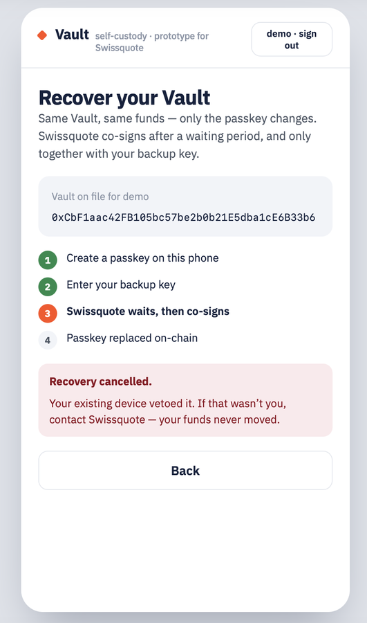
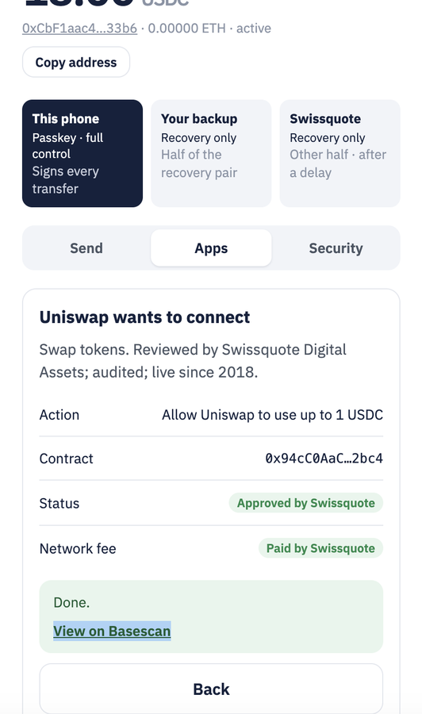
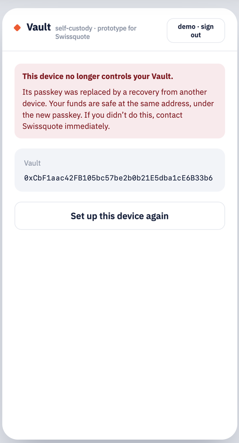

# Swissquote Vault

A self-custody crypto wallet that Swissquote could realistically launch for its clients:
**their keys, their control — one step away from their Swissquote account.**

Built in 24 hours at the BSA EPFL Hackathon (10–11 October 2026), Swissquote Wallet track.

## The idea in one paragraph

Today a Swissquote client who wants self-custody has to withdraw to MetaMask and leave the bank.
Swissquote Vault is a smart-contract wallet (ERC-4337) on an Ethereum L2 where the everyday signer
is a **passkey** living in the secure enclave of the client's phone (Face ID / Touch ID to sign).
Recovery uses a **2-of-2 recovery pair**: a Swissquote guardian key tied to the client's KYC'd bank account,
and a client-held backup key. Together they can do exactly one thing: install a new passkey. Swissquote alone can never move funds, so the
bank is not a custodian; the client alone can transact. Losing a phone is recoverable; stealing a
phone is not profitable, because recovery requires a bank-grade identity check **plus** a time delay
with a one-tap cancel on the old device.

## What it looks like

| Create with a passkey | Review before signing | Approved apps only | Attacker's recovery cancelled |
| --- | --- | --- | --- |
|  |  |  |  |

| Backup kit, shown once | Gasless USDC sent | Connect a dApp (limited approval) | Old phone after recovery |
| --- | --- | --- | --- |
|  |  |  |  |

## Repo layout

| Folder | What lives there |
| --- | --- |
| `app/` | The wallet prototype (web app, runs on testnet) |
| `docs/` | Architecture, threat model, custody model, Swiss legal notes, business case, pitch |

## Status

Working end to end on Base Sepolia: passkey wallet creation, gasless USDC transfers, approved-dApp interaction,
sanctions block, and lost-phone recovery (backup key + Swissquote guardian after a delay) followed by signing
with the new passkey. Start with [`app/README.md`](app/README.md) to run it and [`docs/`](docs/) for the design.

## Team

Ali Torkaman and team · BSA EPFL Hackathon 2026
