# Swissquote Vault

A self-custody crypto wallet that Swissquote could realistically launch for its clients:
**their keys, their control — one step away from their Swissquote account.**

Built in 24 hours at the BSA EPFL Hackathon (10–11 October 2026), Swissquote Wallet track.

## The idea in one paragraph

Today a Swissquote client who wants self-custody has to withdraw to MetaMask and leave the bank.
Swissquote Vault is a smart-contract wallet (ERC-4337) on an Ethereum L2 where the everyday signer
is a **passkey** living in the secure enclave of the client's phone (Face ID / Touch ID to sign).
Recovery keys can do exactly one thing, enforced on-chain: install a new passkey. Their weights are the custody model:
**client backup key 60, Swissquote 40, an independent recovery partner 40, threshold 100**. The client's backup key is
always required; Swissquote alone, or Swissquote together with the partner (80), can never move or recover the funds, so
the bank is not a custodian; the client alone can transact. Losing a phone is recoverable, even if Swissquote is gone
(backup + partner); stealing a phone and the email inbox gets an attacker nothing (their key is not the Vault's
backup key, which the on-chain recovery rules require, and Swissquote refuses to co-sign; shown live).

## What it looks like

| Create with Face ID | Backup kit, shown once | Home: balance, actions, protection |
| --- | --- | --- |
| 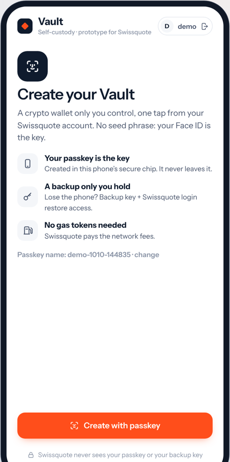 | 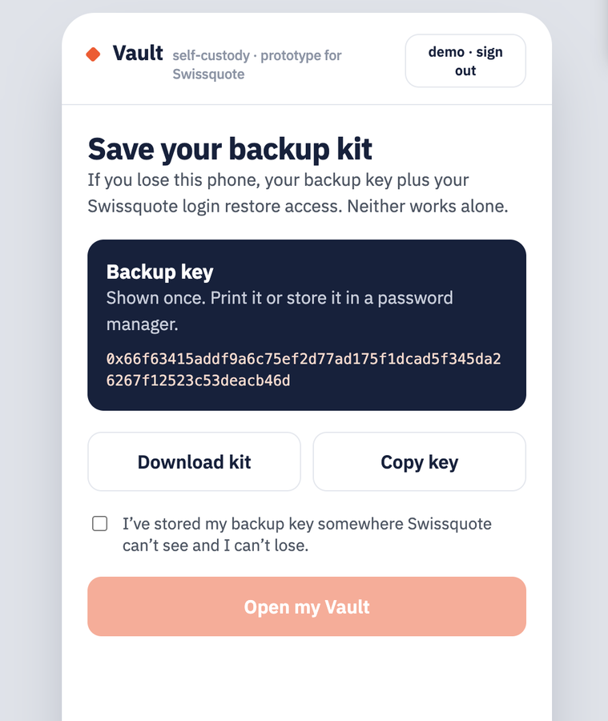 | 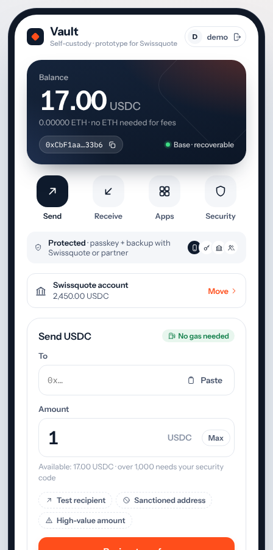 |

| Checks before every signature | Approved apps only | Receive |
| --- | --- | --- |
| 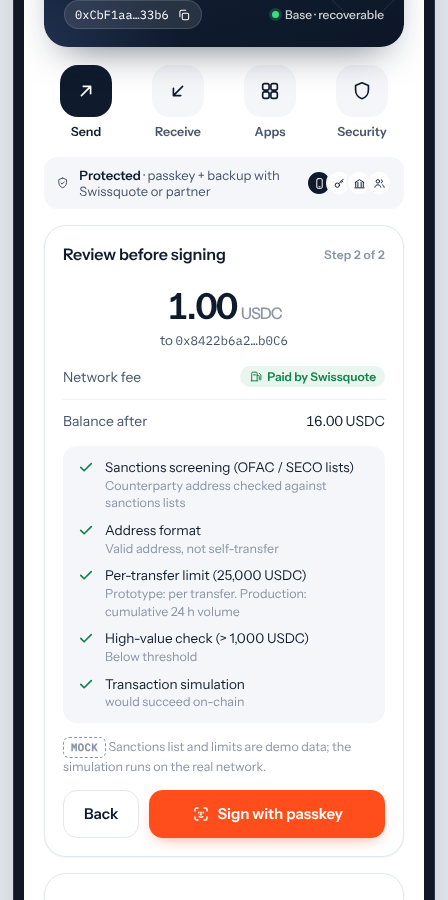 | 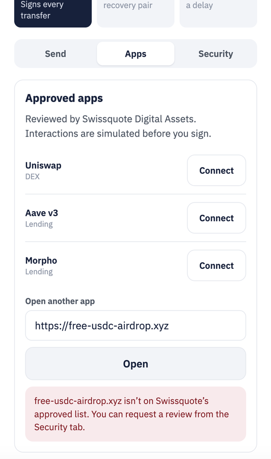 | 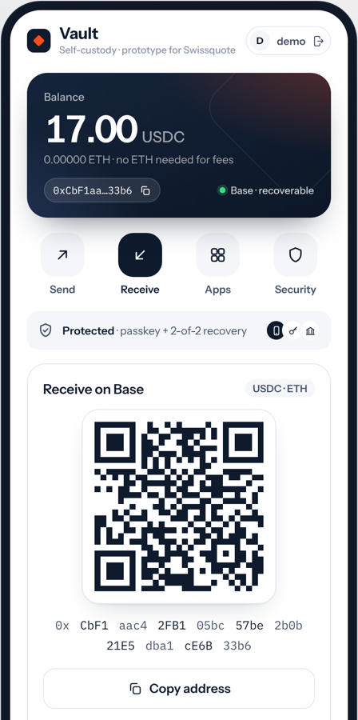 |

| Lost phone: recovery | Old phone: "someone is recovering" + veto | Where the keys live, ownership proof |
| --- | --- | --- |
| 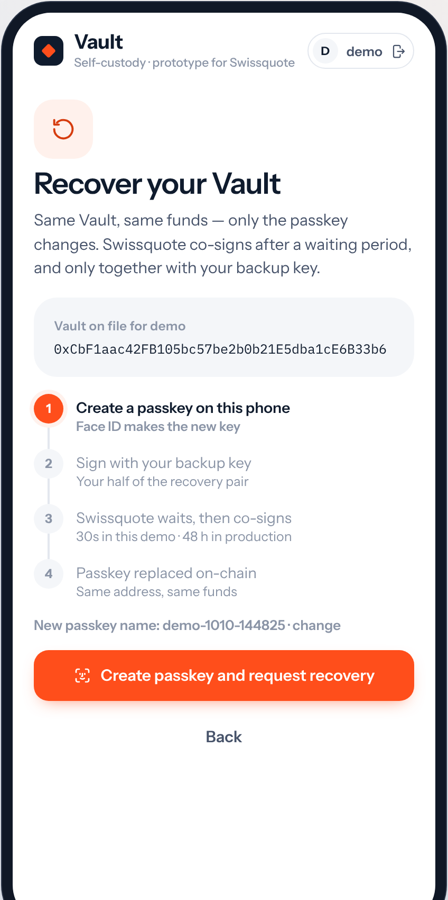 | 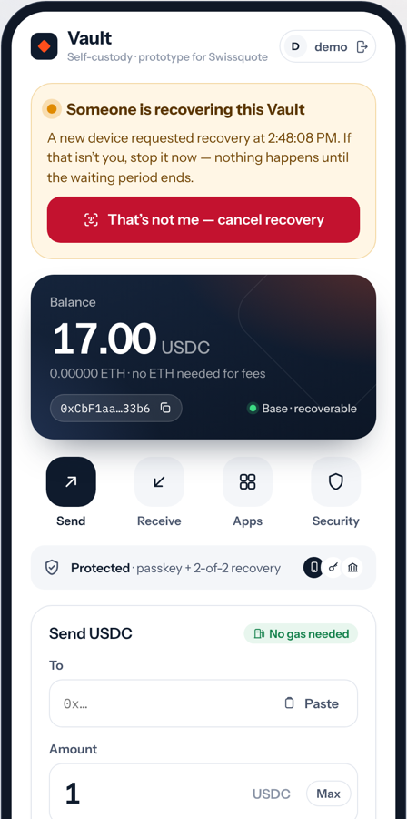 | 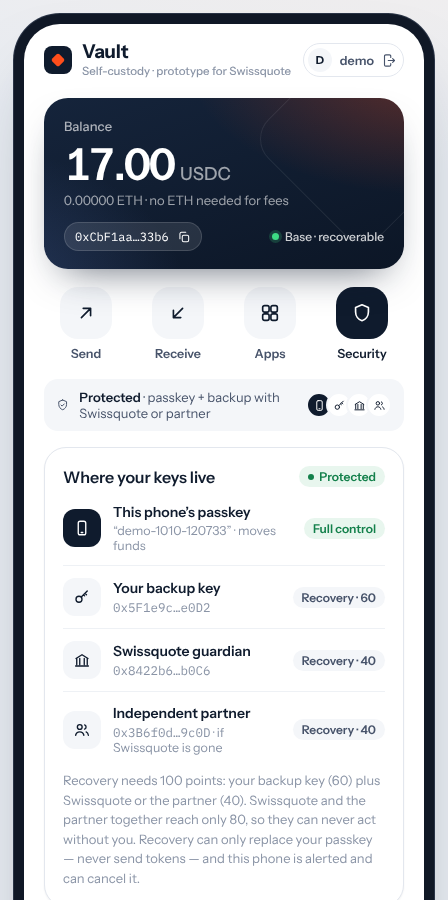 |

| Thief with phone + email: refused | Swissquote switched off: Vault still works | Recover without Swissquote |
| --- | --- | --- |
| 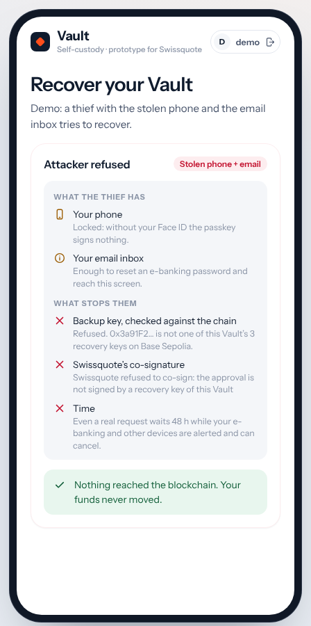 | 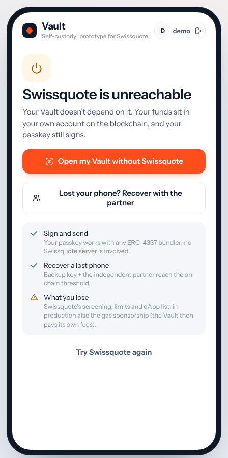 | 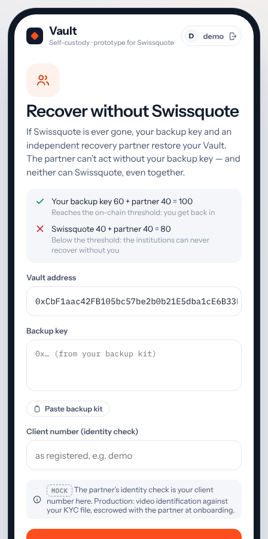 |

## For judges: where each required topic is answered

| Required topic (challenge brief) | Where |
| --- | --- |
| 1. Custody model, pros/cons, threat model (who could steal, who could lock out, could Swissquote alone or with a partner move funds?) | `docs/custody-model.md` ("The three questions", model comparison), `docs/threat-model.md` (18 scenarios) |
| 2. Architecture diagram, real vs mocked | `docs/architecture.md` (mocked parts marked [MOCK]), `docs/mocks.md`; in-app Real/MOCK legend |
| 3. Wallet creation: where keys are generated and live, link to identity | `docs/custody-model.md` (keys table, lifecycle), `docs/architecture.md` ("Where keys live") |
| 4. Authentication, high-value vs small | Passkey for every signature; step-up with the security code above 1,000 USDC (Send tab, "High-value amount") |
| 5. Recovery: who, how long, what stops an attacker, **what if Swissquote is gone** | Live demo; attacker with phone + email refused live; "Switch Swissquote off" + partner recovery; `docs/threat-model.md`, `docs/legal-swiss.md` |
| 6. Business case | `docs/business-case.md` |
| Submission: custody + Travel Rule, bonus topics, **AI tools used** | `docs/submission.md`, `docs/legal-swiss.md` ("Travel Rule"), [AI tools](#ai-tools-used) below |
| Mocked share holders run as separate processes with their own storage | `server/index.ts` (+ `data.json`) and `server/partner.ts` (+ `partner-data.json`); the app never holds a guardian key |

| Judging criterion | Evidence |
| --- | --- |
| **Technical implementation (35)** — create → authenticate → sign → lose → recover, real transaction on a blockchain | Live demo on Base Sepolia (`docs/demo-script.md`); code in `app/src/lib/wallet.ts`, `app/src/lib/recovery.ts`; unit tests + CI (`app/tests`, `.github/workflows/ci.yml`) |
| **Security & custody design (20)** — custody model, threat model, architecture, where keys live, authentication before signing | `docs/custody-model.md`, `docs/threat-model.md` (18 scenarios), `docs/architecture.md`, `docs/security-review.md`; in-app: Security tab, recovery alert + passkey-signed veto, old device locked out |
| **Legal feasibility (15)** — Swiss custody rules, wallet ownership verification | `docs/legal-swiss.md` (FINMA sources); in-app: one-tap ownership proof verified on-chain (Security tab) |
| **Business case (15)** | `docs/business-case.md` (Swissquote's 2025 / H1 2026 figures, labelled assumptions), `docs/roadmap.md` |
| **UX & pitch (15)** | Phone-shaped app, plain-language copy, no seed phrase; deck + script in `docs/pitch.md` |
| **Bonus: gasless** | Every operation sponsored by the paymaster; client never holds ETH (Send tab: "Paid by Swissquote"). Who pays and abuse prevention: `docs/architecture.md` |
| **Bonus: compliant dApp interaction** | Approved-dApp list, unknown sites blocked, limited approvals with on-chain allowance + revoke, sanctions screening, simulation, 2FA step-up above 1,000 USDC |
| **Bonus: recovery that refuses an attacker with the stolen phone and email** | Live: Recover → "Demo: try as a thief" → the key is not the Vault's backup key and is refused, and Swissquote refuses to co-sign. Plus waiting period and passkey-signed veto (`docs/threat-model.md`) |
| **Bonus: Swiss regulatory considerations** | `docs/legal-swiss.md`, ownership proof in-app |
| **What is mocked** (required disclosure) | `docs/mocks.md` |

## Repo layout

| Folder | What lives there |
| --- | --- |
| `app/` | The wallet prototype (web app, runs on testnet) |
| `docs/` | Architecture, threat model, custody model, Swiss legal notes, business case, pitch |

## Status

Working end to end on Base Sepolia: passkey wallet creation, gasless USDC transfers, approved-dApp interaction,
sanctions block, and lost-phone recovery (backup key + Swissquote guardian after a delay) followed by signing
with the new passkey. Added after reading the full challenge brief: the independent recovery partner (recovery
without Swissquote), the on-chain checks of the backup key by app and guardians, and the live attacker refusal. Start with [`app/README.md`](app/README.md) to run it and [`docs/`](docs/) for the design.

## AI tools used

- **Claude (Anthropic), in the Claude app with agentic coding:** wrote the application code, the mock services, tests and CI, the documentation, the pitch deck and the demo script, following our instructions and decisions; researched FINMA sources, Swissquote's published figures and the ZeroDev contracts.
- **What we did ourselves:** chose the direction and trade-offs, ran and tested every flow on our own devices (Mac with Chrome and Safari, iPhone via cross-device passkeys), reported bugs, reviewed the outputs, and present the project.
- No other AI tools were used. No custom cryptography: all signing uses WebAuthn, viem and the audited ZeroDev contracts.

## Team

Ali Torkaman and team · BSA EPFL Hackathon 2026
