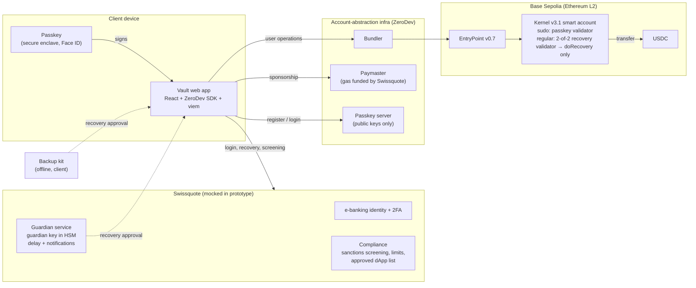
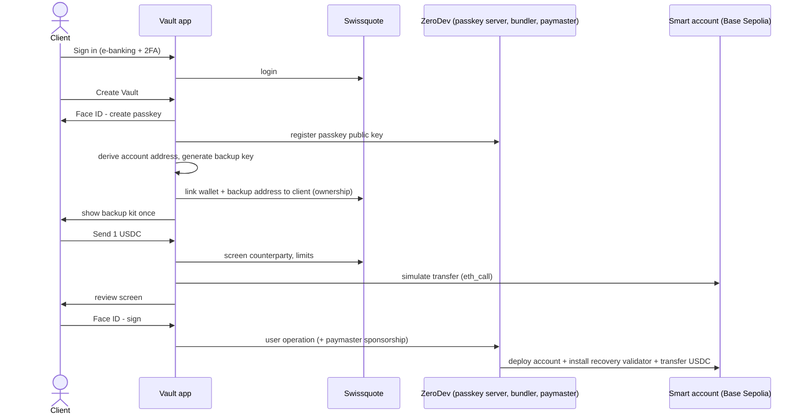
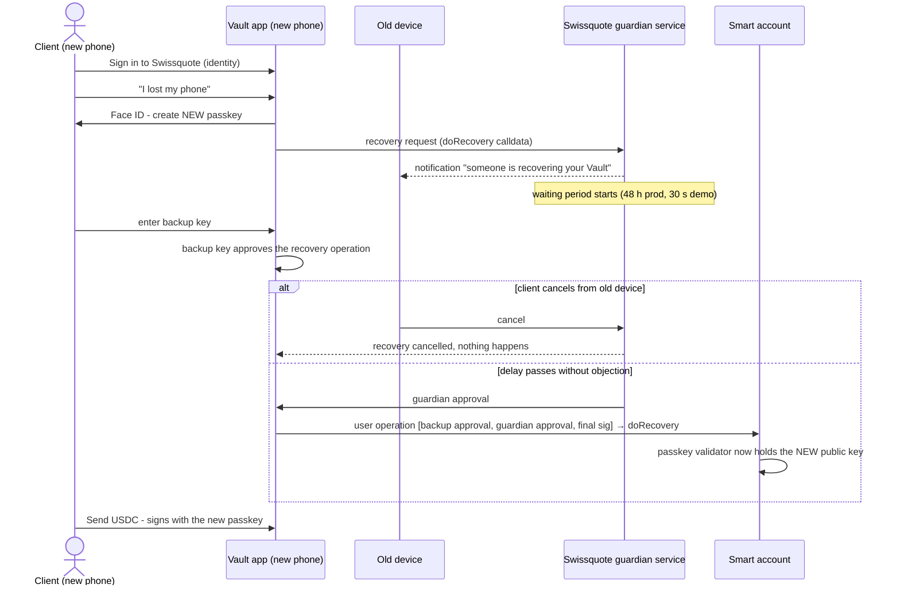

# Architecture

## Components

| Component | Real or mocked | Role |
| --- | --- | --- |
| Passkey (WebAuthn, P-256) | Real | The client's everyday key. Private key never leaves the secure enclave; every signature requires biometric user verification |
| Kernel v3.1 smart account (ERC-4337) | Real, Base Sepolia | Holds the funds. Validators decide who may sign what |
| Passkey validator (sudo) | Real | Verifies P-256 WebAuthn signatures on-chain |
| Weighted validator (regular, 2-of-2) | Real | Recovery signers: Swissquote guardian (50) + client backup (50), threshold 100, bound to `doRecovery` |
| Recovery action (`doRecovery`) | Real (ZeroDev, audited) | Re-initialises the passkey validator with a new public key |
| Paymaster | Real (ZeroDev) | Pays gas so the client never holds ETH. In production Swissquote funds it |
| Bundler | Real (ZeroDev) | Submits user operations to the EntryPoint |
| Passkey server | Real (ZeroDev) | Stores passkey **public** keys so a client can log in by name on any device. Production: self-hosted by Swissquote |
| e-banking login, guardian service, compliance | **Mocked** (`app/server/index.ts`) | See `mocks.md` |

No custom smart contracts and no custom cryptography: everything on-chain is ZeroDev's Kernel and plugin contracts, and all signing uses WebAuthn, viem and the ZeroDev SDK.

## Where keys live

| Secret | Location | Leaves the device? | Swissquote sees it? |
| --- | --- | --- | --- |
| Passkey private key | Phone secure enclave (or OS passkey sync) | Never | No |
| Passkey public key | Smart account (on-chain) + passkey server | Yes (public) | Yes (public) |
| Backup private key | Backup kit (offline) | Only when the client types it in on a recovery device | **No** |
| Guardian private key | Swissquote HSM | Never | Yes (it's theirs) |

## Authentication before signing

1. **Identity:** the client signs in to Swissquote (existing e-banking login + 2FA). This proves *who* the client is and links the wallet to a KYC'd person.
2. **Possession + biometrics:** every on-chain action needs a WebAuthn assertion from the passkey, which the device only releases after Face ID / Touch ID.
3. **User verification:** WebAuthn `userVerification: required` means biometrics or the device PIN, depending on the device.
4. **Origin binding:** WebAuthn ties the passkey to Swissquote's domain. A phishing site on another domain cannot ask for a signature with it.
5. **Review:** before the passkey prompt, the client sees recipient, amount, fee (sponsored), balance after, compliance checks and an on-chain simulation.

## Sequence: create and first transfer

## Sequence: lost phone recovery

## Compliance layer

| Control | Where | Prototype |
| --- | --- | --- |
| Sanctions screening of counterparty | Before signing | Mock blocklist (`0x…bad1`). Production: Chainalysis / Elliptic, OFAC + SECO lists |
| Daily limit | Before signing | 25,000 USDC, off-chain. Production: also on-chain via a ZeroDev spending-limit policy |
| High-value step-up | Before signing | Above 1,000 USDC, the client is asked to confirm in e-banking |
| Transaction simulation | Before signing | Real `eth_call` simulation on Base Sepolia |
| Approved dApp list | Apps tab | Static list. Unknown dApps are blocked. Allowances read from chain; one-tap revoke |
| Wallet ownership proof | Security tab | Bank challenge → passkey signs (ERC-1271) → bank verifies on-chain |
| Recovery veto | Old device | Signed by the current passkey (ERC-1271); fallback: authenticated session |
| Gas sponsorship | Every operation | Real paymaster; policy can be restricted to approved contracts |

## Known limitations (honest list)

- The recovery validator is installed on-chain by the activation operation right after creation (or, if that fails, by the first transfer). Until then a wallet is not yet recoverable; the UI shows "activates with your first transfer" in that state.

- Compliance checks are enforced by the app and backend, not on-chain. A client using the passkey from a different app could bypass them. This is acceptable for self-custody (it is the client's money) and matches how the screening is meant to protect the client and Swissquote's sponsored gas, not to control funds.
- The recovery delay is enforced by the guardian service in the prototype. Production sets the validator's on-chain `delay` as well.
- One chain (Base Sepolia). Same design works on any EVM chain with an ERC-4337 EntryPoint.
