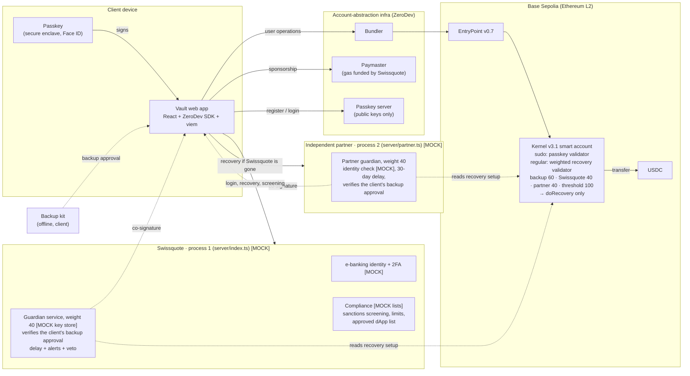
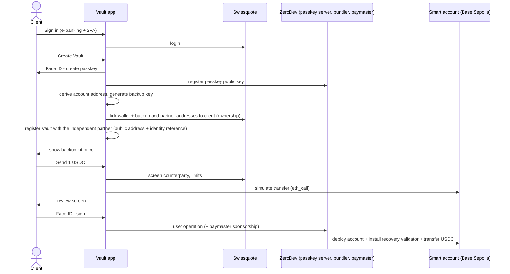
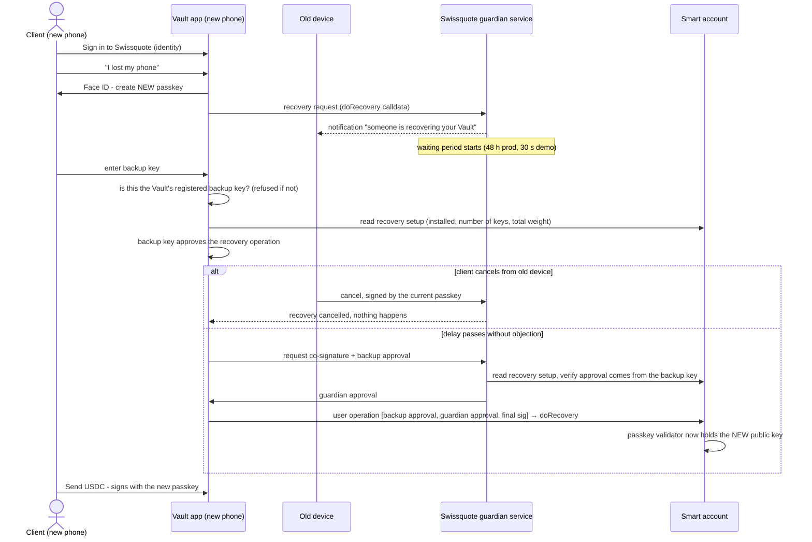
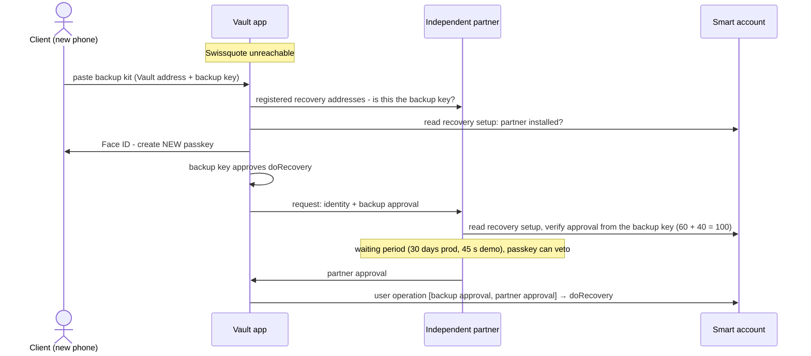

# Architecture

## Components

Legend: **[MOCK]** marks parts mocked in the prototype; everything else is real and running on Base Sepolia. Each mocked guardian runs as its own process with its own storage; the client app never holds a guardian key.

| Component | Real or mocked | Role |
| --- | --- | --- |
| Passkey (WebAuthn, P-256) | Real | The client's everyday key. Private key never leaves the secure enclave; every signature requires biometric user verification |
| Kernel v3.1 smart account (ERC-4337) | Real, Base Sepolia | Holds the funds. Validators decide who may sign what |
| Passkey validator (sudo) | Real | Verifies P-256 WebAuthn signatures on-chain |
| Weighted validator (regular) | Real | Recovery keys: client backup (60) + Swissquote (40) + partner (40), threshold 100, bound to `doRecovery`. Legacy Vaults: backup 50 + Swissquote 50 |
| Recovery action (`doRecovery`) | Real (ZeroDev, audited) | Re-initialises the passkey validator with a new public key |
| Paymaster | Real (ZeroDev) | Pays gas so the client never holds ETH. In production Swissquote funds it |
| Bundler | Real (ZeroDev) | Submits user operations to the EntryPoint |
| Passkey server | Real (ZeroDev) | Stores passkey **public** keys so a client can log in by name on any device. Production: self-hosted by Swissquote |
| e-banking login, Swissquote guardian, compliance | **Mocked** (`app/server/index.ts`, process 1, `data.json`) | See `mocks.md`. The guardian's co-signature and its on-chain checks are real |
| Independent recovery partner | **Mocked** (`app/server/partner.ts`, process 2, `partner-data.json`) | Fictional Swiss trust company. Identity check mocked; co-signature and on-chain checks real |
| Guardian checks shared by both | Real (`app/server/guardian.ts`) | Check the Vault's on-chain recovery setup against the registered public addresses; verify the backup approval; refuse if it doesn't reach the threshold |

No custom smart contracts and no custom cryptography: everything on-chain is ZeroDev's Kernel and plugin contracts, and all signing uses WebAuthn, viem and the ZeroDev SDK.

## Where keys live

| Secret | Location | Leaves the device? | Swissquote sees it? |
| --- | --- | --- | --- |
| Passkey private key | Phone secure enclave (or OS passkey sync) | Never | No |
| Passkey public key | Smart account (on-chain) + passkey server | Yes (public) | Yes (public) |
| Backup private key | Backup kit (offline) | Only when the client types it in on a recovery device | **No** |
| Swissquote guardian key | Swissquote HSM (mock: process 1's own file) | Never | Yes (it's theirs) |
| Partner guardian key | Partner's HSM (mock: process 2's own file) | Never | **No** |

## Authentication before signing

1. **Identity:** the client signs in to Swissquote (existing e-banking login + 2FA). This proves *who* the client is and links the wallet to a KYC'd person.
2. **Possession + biometrics:** every on-chain action needs a WebAuthn assertion from the passkey, which the device only releases after Face ID / Touch ID. Opening the app is gated the same way: a Vault remembered on the device shows a lock screen, and only a passkey assertion opens it. The Swissquote login alone never does.
3. **User verification:** WebAuthn `userVerification: required` means biometrics or the device PIN, depending on the device.
4. **Origin binding:** WebAuthn ties the passkey to Swissquote's domain. A phishing site on another domain cannot ask for a signature with it.
5. **Review:** before the passkey prompt, the client sees recipient, amount, fee (sponsored), balance after, compliance checks and an on-chain simulation.

## Sequence: create and first transfer

## Sequence: lost phone recovery

## Sequence: recovery when Swissquote is gone

## Gas sponsorship: who pays, and how abuse is prevented

**Who pays:** Swissquote. Every Vault operation goes through a paymaster funded by Swissquote, so the client never needs ETH. A USDC transfer on Base costs about 0.000002 ETH (the app shows the real fee of each operation in Activity), i.e. well under CHF 1 per client per year at normal usage (`business-case.md`).

**How abuse is prevented (production policy):**

| Control | What it stops |
| --- | --- |
| Sponsor only Vaults registered to a KYC'd Swissquote client (the paymaster decision goes through Swissquote's backend, e.g. ZeroDev's custom-webhook policy, with the API key server-side) | Strangers using Swissquote's paymaster |
| Sponsor only calls to USDC, approved dApps and `doRecovery` | Arbitrary contract spam paid by Swissquote |
| Per-account rate limit and monthly gas budget (ZeroDev gas policies support per-wallet and per-contract limits) | A compromised or abusive client draining the budget |
| No sponsorship for transfers that fail screening | Swissquote paying for sanctioned transfers |
| Gas sponsorship is a service in the terms; the client can always pay gas themselves | Dependence on Swissquote |

**Prototype:** the ZeroDev testnet project uses "sponsor all transactions"; the policy above is documented, not enforced. Abuse on testnet costs nothing real.

## Compliance layer

| Control | Where | Prototype |
| --- | --- | --- |
| Sanctions screening of counterparty | Before signing | Mock blocklist (`0x…bad1`). Production: Chainalysis / Elliptic, OFAC + SECO lists |
| Daily limit | Before signing | 25,000 USDC per transfer, off-chain (prototype). Production: cumulative 24 h, plus an on-chain ZeroDev spending-limit policy |
| High-value step-up | Before signing | Above 1,000 USDC the client also enters the Swissquote security code (step-up; mock code 000000) |
| Transaction simulation | Before signing | Real `eth_call` simulation on Base Sepolia |
| Approved dApp list | Apps tab | Static list. Unknown dApps are blocked. Allowances read from chain; one-tap revoke |
| Wallet ownership proof | Security tab, Move to Swissquote | Bank challenge → passkey signs (ERC-1271) → bank verifies on-chain |
| Travel Rule check on deposits | Move (Vault → Swissquote) | Bank reads the USDC transfer on-chain; credits only from the client's proven Vault, keeps the originator/beneficiary record; other senders held |
| Travel Rule check on withdrawals | Move (Swissquote → Vault) | Bank sends real USDC from its treasury smart account (gas sponsored) only to the client's proven Vault; other destinations refused |
| Recovery veto | Old device | Signed by the current passkey (ERC-1271); fallback: authenticated session |
| Gas sponsorship | Every operation | Real paymaster; production policy above |
| Recovery approvals | Both guardians | Backup approval verified (registered backup key, on-chain recovery setup) before co-signing |

## Known limitations (honest list)

- The recovery validator is installed on-chain by the activation operation right after creation (or, if that fails, by the first transfer). Until then a wallet is not yet recoverable; the UI shows "activates with your first transfer" in that state.

- Compliance checks are enforced by the app and backend, not on-chain. A client using the passkey from a different app could bypass them. This is acceptable for self-custody (it is the client's money) and matches how the screening is meant to protect the client and Swissquote's sponsored gas, not to control funds.
- The recovery delay is enforced by the guardian services in the prototype. The validator we use only supports off-chain signature collection with `delay = 0`; production would move recovery to ZeroDev's `WeightedECDSAValidator`, which starts an on-chain timer when guardians approve (`approveWithSig`) and lets the account `veto` (see `custody-model.md`).
- Old devices learn that a partner recovery completed only when Swissquote is reachable again; the partner path is a last resort.
- One chain (Base Sepolia). Same design works on any EVM chain with an ERC-4337 EntryPoint.
